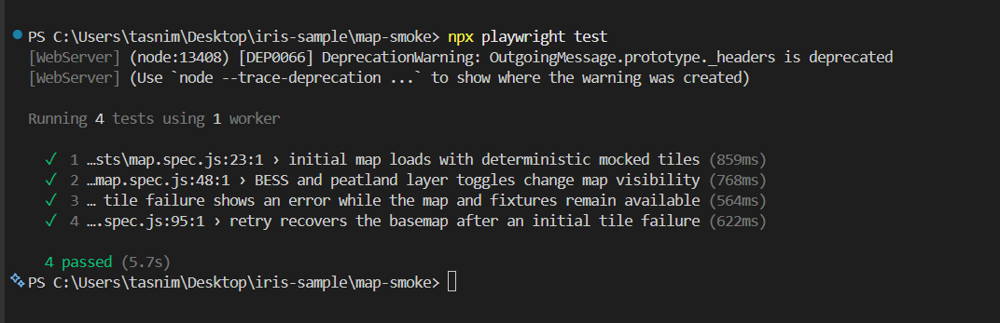
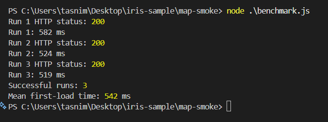
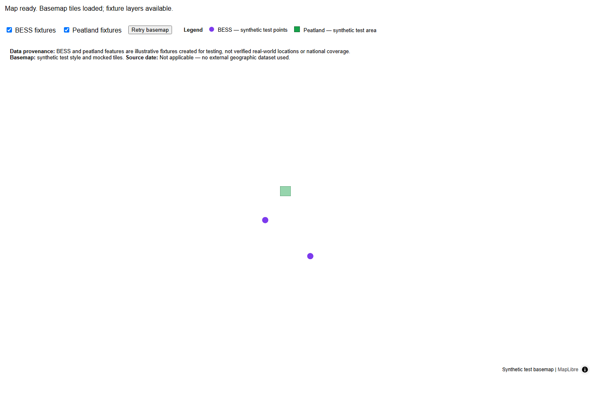
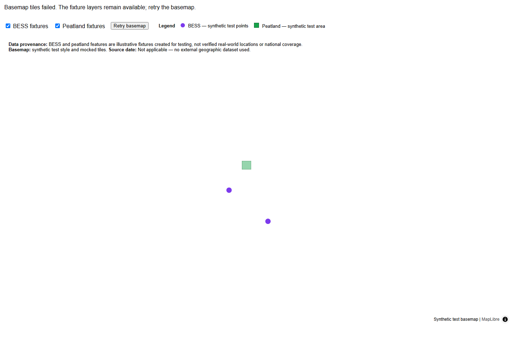

# IRIS Map Smoke Test — Assessment Notes

## 1. Overview

This assessment investigates map initialization, basemap loading, and the display of BESS and peatland fixture layers.

I created a standalone MapLibre harness with Playwright smoke tests to check initial map loading, layer visibility, tile-failure handling, and retry recovery.

The harness uses synthetic fixtures and mocked tile responses. It is intended to provide a controlled test environment, not to claim that the production dashboard has been fixed.

## 2. Why I Used a Separate MapLibre Harness

The production dashboard uses **Streamlit and PyDeck**, whereas the assessment harness uses MapLibre.

I chose a separate harness because it allowed me to:
- Reproduce map-loading scenarios in a controlled, repeatable environment.
- Mock tile responses and simulate tile failures without depending on an external basemap service.
- Test initial loading, layer toggles, error states, and recovery using Playwright.
- Avoid introducing unnecessary changes or regression risks in the existing production dashboard.

This approach isolates the map behavior being tested and makes the smoke tests deterministic. However, it does **not** prove that the production Streamlit/PyDeck map has the same issue or that its initialization has been fixed. The production map's initialization path would need to be investigated and tested separately.

## 3. What I Implemented

- A standalone MapLibre map harness.
- Synthetic BESS fixture points.
- A synthetic peatland polygon.
- A legend and layer toggles.
- Basemap attribution and fixture provenance information.
- Loading, ready, and error status handling.
- A retry action after tile-loading failures.
- Playwright smoke tests for initialization, layer visibility, failure handling, and recovery.
- A three-run first-load latency benchmark.

### Key terms

- **BESS:** Battery Energy Storage System.
- **Fixture:** Small test data used to validate application behavior.
- **Smoke test:** A basic automated test that checks whether a key feature works.
- **First-load latency:** The elapsed time from navigation until the harness reports that the map is ready.

## 4. Setup

Run these commands from the `map-smoke` directory:

```powershell
npm install
npx playwright install chromium
```

Start the local server:

```powershell
npx http-server . -p 4173 -a 127.0.0.1
```

In a second terminal, also inside `map-smoke`, run the tests:

```powershell
npx playwright test
```

Run the latency benchmark:

```powershell
node .\benchmark.js
```

Capture the map evidence:

```powershell
node .\capture-evidence.js
```

## 5. Smoke Test Results

The latest test run completed successfully: **4 tests passed**.

The tests check:

1. Initial map initialization, ready status, and fixture availability.
2. BESS and peatland layer visibility toggles.
3. Display of an error when tile requests fail, while the map and fixtures remain available.
4. Recovery after retrying following an initial tile failure.

These results apply to the standalone test harness and its mocked environment.

## 6. First-Load Latency Benchmark

Three successful runs produced the following measurements:

| Run | First-load time |
|---|---:|
| 1 | 582 ms |
| 2 | 524 ms |
| 3 | 519 ms |
| **Mean** | **542 ms** |

The benchmark uses a local server and mocked tile responses. These figures are **not production measurements** and should not be interpreted as real-world basemap or network performance.

## 7. Screenshots and Evidence

The assessment screenshots in screenshots folder directory and The harness-generated screenshots are stored in map-smoke folder:

### Automated test results



### First-load latency benchmark



### Evidence capture


### Map initialization



### Tile failure handling



The map screenshots use mocked, transparent tile responses, so they demonstrate application states rather than realistic geographic detail.

To copy the generated map screenshots into the root evidence folder, run these commands from the repository root:

```powershell
New-Item -ItemType Directory -Force .\screenshots
Copy-Item .\map-smoke\evidence-initial-load.png .\screenshots\map-initial-load.png
Copy-Item .\map-smoke\evidence-tile-failure.png .\screenshots\map-tile-failure.png
```

Capture the terminal screenshots manually and save them using the filenames listed above.

## 8. Data Provenance, Attribution, and Licensing

The BESS points and peatland polygon are synthetic test fixtures. They are not verified real-world asset locations and do not represent national coverage.

No external geographic dataset was used for these fixtures, so a source date is not applicable. The harness identifies its basemap as synthetic test data and includes attribution information.

Before integrating real geographic data, its source, licensing terms, attribution requirements, and source date must be verified and documented.

## 9. Limitations and Next Steps

- The harness tests MapLibre, not the production Streamlit/PyDeck renderer.
- Mocked tile responses do not validate an external basemap provider or real network behavior.
- The current results do not establish a production fix or provide a production before-and-after comparison.
- The synthetic fixtures are for testing only and must not be presented as verified geographic data.

A sensible next step is to inspect the production dashboard's map initialization and configuration, then add a controlled regression test for the actual Streamlit/PyDeck implementation. Any production change should be small, evidence-based, and validated against the existing dashboard.
